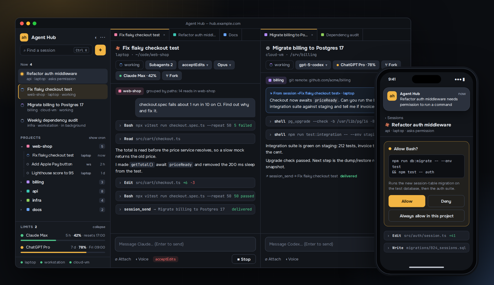
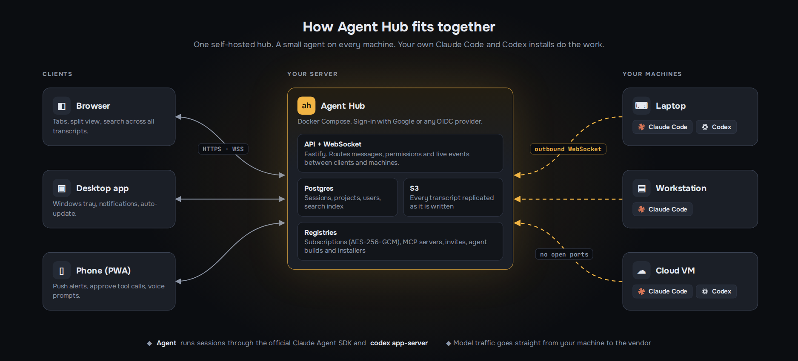

<div align="center">

# Agent Hub

**Every Claude Code and Codex session on every machine you own, in one window.**

Start an agent on your workstation from your phone. Let it sleep when idle and wake it with full context.
Fork it, search it, hand it off to another machine or another vendor, and never lose a transcript again.

[Hosted](https://getagenthub.dev) · [Why](#why) · [Features](#features) · [How it works](#how-it-works) · [Self-host](#self-host) · [Roadmap](#roadmap) · [License](#license)


</div>



<sub>The interface speaks English, 中文, Español, Português, Deutsch, Français, 日本語, 한국어, ไทย and Русский.</sub>

---

## Why

Coding agents moved from «one chat in one terminal» to «a dozen long-running sessions across a laptop, a desktop and a cloud VM». The terminal didn't keep up:

- **Sessions are scattered.** Each machine has its own `~/.claude/projects`. Finding *that* conversation from last Tuesday means SSH-ing around and grepping JSONL.
- **You are chained to the keyboard.** An agent asks for permission while you're away — it waits for hours. You can't start a task from your phone.
- **Context dies with the terminal.** Close the window, reboot the laptop, and the session is gone unless you remember its ID.
- **Subscriptions run out mid-task.** You have two Claude plans and a ChatGPT plan, and switching between them is manual surgery on credentials.
- **Agents can't talk to each other.** A Claude session on your laptop can't ask a Codex session on the VM to run the tests.

Agent Hub is a small self-hosted server plus a lightweight agent on each machine. It turns all of those sessions into one workspace you can reach from a browser, a phone or a desktop app.

## Features

### One workspace for all machines
- **Live sidebar** of every session on every connected machine — status at a glance: working, waiting for you, asking permission, running in background, asleep.
- **Tabs and split view**, keyboard-first, with full-text search across all transcripts (`Ctrl K`).
- **Automatic project grouping**: sessions land in a project based on which files and git remotes they actually touched — no manual tagging. A classifier suggests a project (or a new one) for sessions it is unsure about; you can pin a session by hand and give projects colors.
- **Rename sessions** inline, or regenerate the title from the whole transcript.
- **Start new sessions from the UI** on any machine, in any folder, with any model and permission mode.
- **Agents know your projects.** The project catalogue (names, descriptions, git remotes, folders on this machine) is added to the instructions of every Claude and Codex session, so an agent can find the right repo without asking.
- **Ten interface languages** — picked from the browser by default, switchable in Settings and saved to your profile across devices. Prompts and tool texts for the model stay in English.

### Tool windows
- **File explorer** next to the chat: browse the session's folder, the project or the whole machine, open text, images and PDFs in the workspace as tabs. Read-only, with credential files hidden and size limits; it works through the agent, so nothing is exposed on the machine.
- **Dockable windows** on a left or right icon rail — drag a window to the other side; on a phone they open from a drawer.
- **Image viewer** with zoom, pan and a session-wide image list.

### Sessions that survive
- **Sleep and resume.** Idle sessions release their process and memory; a new message resumes them exactly where they stopped.
- **Fork** any session — as a full copy, or as a compact handoff summary for a fresh context.
- **Every transcript replicated** to Postgres and S3 as it's written. A dead laptop doesn't take your history with it.
- **Background tasks visible**: monitors and background shells show up with status and expiry, and keep the session awake while they run.

### Work from anywhere
- **Installable PWA** for phone and tablet, plus a Windows desktop app with tray and notifications.
- **Push notifications** when an agent finishes or needs permission — approve tool calls from your phone.
- **Voice input** for prompts (ElevenLabs Scribe).

### Subscriptions and limits
- **Several Claude and ChatGPT subscriptions** in one registry, encrypted at rest (AES-256-GCM).
- **Pick a subscription per session**, switch it on the fly, and **auto-switch when one hits its limit**.
- **Usage and limits** per subscription: 5-hour and weekly windows, reset times, spend. A ring on the rail shows the tightest limit at a glance; details live in the Subscriptions window.

### MCP without the pain
- **MCP panel per session**: server status, reconnect, enable/disable, OAuth sign-in to remote MCP servers *through the hub* — no localhost callbacks on a headless box.
- **MCP registry**: configure a server once, use it on every machine; secrets stay in the hub.

### Agents that cooperate
- **Session-to-session messaging.** Every session gets an `agent-hub` MCP server with `sessions_list`, `session_get` and `session_send` — agents can find each other and exchange messages across machines.
- **Cross-vendor subagents.** `session_spawn` starts a child session on another machine or with another vendor (Claude → Codex and back). The parent gets a report after each turn of the child.

### Team-ready
- **Multi-user** with Google (or any OIDC) sign-in and invites; every user sees only their own machines and sessions.
- **Several public addresses** for one hub (`EXTRA_PUBLIC_URLS`): sign-in and WebSocket work on each, no redirects.
- **One-line machine enrollment**: `curl … | bash` on Linux and macOS, one PowerShell line on Windows. Agents update themselves from the hub.

## How it works



- **Hub** (`hub/`) — Node.js + Fastify, Postgres, S3. Serves the web app, the agent builds and the installers.
- **Agent** (`agent/`) — a small Node.js service on each machine. It runs sessions through the official [Claude Agent SDK](https://docs.claude.com/en/api/agent-sdk/overview) and `codex app-server`, tails existing transcripts, and connects to the hub with an **outbound** WebSocket — no open ports on your machines.
- **Web** (`web/`) — React + Vite PWA. **Desktop** (`desktop/`) — Electron wrapper with tray, notifications and auto-update.
- Sessions run under your own Claude Code / Codex install and your own subscriptions. Agent Hub doesn't proxy model traffic.

## Hosted instance

A cloud installation runs at **[getagenthub.dev](https://getagenthub.dev)**: sign in, connect your machines with the one-line installer and use it without running a server of your own. The same code is what you get when you self-host.

## Self-host

Requirements: a Linux host with Docker, a domain with TLS (any reverse proxy), a Google OAuth client, an AWS S3 bucket (transcripts are replicated there; `/healthz` reports 503 until it is reachable).

```bash
git clone https://github.com/jonasasx/agent-hub.git
cd agent-hub
cp .env.example .env && chmod 600 .env   # fill in PUBLIC_URL, OIDC, S3, secrets
docker compose --env-file .env -f deploy/compose.selfhost.yml up -d --build
```

The hub listens on `127.0.0.1:8080`. Point your reverse proxy at it (WebSocket upgrade on `/ws/*` must pass through), open `PUBLIC_URL`, sign in with an email from `OIDC_ALLOWED_EMAILS`, then open **Machines → Connect a machine** and run the one-liner on each computer.

Every option is documented inline in [`.env.example`](.env.example).

### Development

```bash
npm ci
npm run build
npm test          # unit tests (vitest)
npm run lint
```

Node.js ≥ 22. Integration tests (`*.int.test.ts`) need a Postgres instance.

## Roadmap

Agent Hub is used daily on three machines by its author and is under active development. Honest status:

- [x] **Localized UI** — ten languages, English by default.
- [x] Project catalogue kept in the hub database; grouping by folder, git remote and touched files, no vault needed.
- [ ] S3-compatible storage (MinIO) and a fully local mode without S3.
- [ ] macOS and Linux desktop builds.
- [ ] More agent vendors (Gemini CLI, OpenCode).

Ideas and bug reports are welcome in [Issues](https://github.com/jonasasx/agent-hub/issues).

## Contributing

Pull requests are welcome. Before a PR: `npm run lint` and `npm test` must pass. Contributors will be asked to sign a CLA, so the project can keep offering a commercial license alongside AGPL.

## License

Agent Hub is licensed under the [GNU Affero General Public License v3.0](LICENSE). You can use, modify and self-host it freely; if you offer a modified version as a network service, you must publish your changes under the same license.

A **commercial license** without AGPL obligations is available — contact [jonasasx@gmail.com](mailto:jonasasx@gmail.com).

Claude and Claude Code are trademarks of Anthropic; Codex and ChatGPT are trademarks of OpenAI. Agent Hub is an independent project, not affiliated with either.
